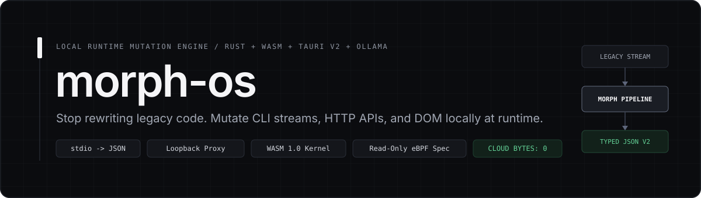
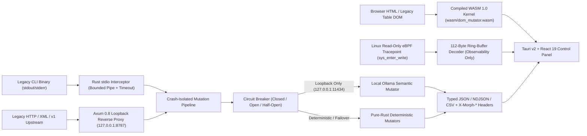

<p align="center">
  
</p>

# Stop rewriting legacy code. Mutate it at runtime. Welcome to morph-os.

**`morph-os`** is a local, zero-cloud runtime mutation layer built in **Rust + WebAssembly 1.0 + Tauri v2 + local Ollama / WebLLM**. It intercepts streams you explicitly wrap (`stdio` pipes, opt-in loopback HTTP/API reverse-proxy traffic, and browser DOM snippets) and reshapes legacy unstructured ASCII tables, XML/SOAP responses, deprecated v1 JSON schemas, PII-bearing logs, and inaccessible HTML tables into strict, typed modern contracts at runtime—without touching or recompiling upstream source code.

---

## 15-Second Demo: Legacy CLI stdout to Strict JSON in 1.4ms

<p align="center">
  
</p>

<!-- Drop-in animated recording slot: replace the commented line below if publishing a screen capture at assets/demo.gif -->
<!--  -->

---

## Why This Exists

Every engineering organization runs on software nobody can safely rewrite: closed-source vendor CLI tools that print misaligned ASCII tables without a `--json` flag, 12-year-old ERP endpoints returning nested XML or `usr_id` v1 schemas, log streams leaking PII across internal tooling, and internal web dashboards rendering raw inaccessible `<table>` markup.

Traditional teams pay a brutal tax: months of glue scripts, brittle regex wrappers, duplicated microservices, or sending sensitive internal payloads to cloud LLM APIs.

**`morph-os` eliminates the rewrite tax.** Instead of modifying legacy binaries or shipping proprietary payloads off-device, `morph-os` places a crash-isolated, deterministic-first runtime mutation layer directly on your loopback boundary:

- **Sub-millisecond deterministic core:** Built-in pure-Rust parsers for fixed-width/bordered/pipe ASCII tables, key-value configs, recursive-descent XML, HTML tables, JSON v1-to-v2 schema translators, and zero-regex PII redactors work 100% offline with zero LLM latency.
- **Optional local semantic engine with Circuit Breaker:** When unstructured output requires semantic normalization, `morph-os` calls local **Ollama** strictly on loopback (`127.0.0.1:11434`, rejecting any non-loopback host) or lazy **WebLLM WebGPU** in the Control Panel. If Ollama is offline, slow, or returns malformed JSON, the built-in **Circuit Breaker** trips cleanly and falls back to deterministic rules or pass-through—never crashing the host OS or dropping traffic.
- **Explicit user-space safety boundaries:** Zero Frida memory injection, zero `ptrace`/DLL injection into unconsented processes, zero kernel syscall tampering, and zero cloud telemetry.

---

## Architecture



---

## Three Production Use Cases

### 1. Force a Closed-Source Legacy CLI Binary to Emit Strict JSON

Wrap any command explicitly after `--`. `morph-os` spawns the child with bounded `stdout`/`stderr` pipes, enforces a hard timeout, isolates panics, forwards the exit code, and emits strict typed JSON, NDJSON, or CSV:

```bash
# Test immediately using the built-in legacy ASCII table simulator:
morph-os run --rule cli-to-json --stats -- morph-os demo-cli

# Or pipe any existing CLI tool into jq / downstream automation:
morph-os run --rule cli-table-to-json --format json -- legacy-inventory-cli --all
morph-os run --rule cli-table-to-json --format csv  -- legacy-inventory-cli --all > inventory.csv
morph-os run --rule cli-table-to-json --engine ollama --model llama3.2 -- legacy-unstructured-cli
```

Example transformed stdout (`1.4ms`, `0` cloud bytes):

```json
[
  {
    "mem_mb": 128.4,
    "pid": 1042,
    "restarts": 0,
    "service": "auth-gateway",
    "state": "RUNNING",
    "uptime_s": 86420
  },
  {
    "mem_mb": 512.0,
    "pid": 1188,
    "restarts": 3,
    "service": "ledger-worker",
    "state": "DEGRADED",
    "uptime_s": 14210
  }
]
```

### 2. Real-Time Legacy XML / v1 API to Modern JSON / v2 Reverse Proxy

Place `morph-os proxy` in front of any legacy local HTTP service. Clients hit `127.0.0.1:8787` and receive schema-normalized JSON responses with transparent observability headers (`X-Morph-Mutated`, `X-Morph-Rule`, `X-Morph-Latency-Ms`, `X-Morph-Engine`, `X-Morph-Circuit`):

```bash
# Translate legacy XML / SOAP upstream responses to REST JSON in real time:
morph-os proxy \
  --listen 127.0.0.1:8787 \
  --upstream http://127.0.0.1:9000 \
  --rule xml-to-json

# Or migrate legacy snake_case v1 REST JSON to camelCase v2 contracts with Ollama fallback:
morph-os proxy \
  --listen 127.0.0.1:8787 \
  --upstream http://127.0.0.1:9000 \
  --rule v1-to-v2-api \
  --engine ollama \
  --ollama-url http://127.0.0.1:11434 \
  --model llama3.2
```

Override rules per request using headers without restarting the proxy:

```bash
curl -i -H "X-Morph-Rule: api-v1-to-v2-translator" http://127.0.0.1:8787/v1/accounts/u_88412
```

Every proxy instance also exposes a local Control Panel REST API under `/_morph/*`:

- `GET /_morph/health` — uptime, active upstream, loaded plugin count, circuit state
- `GET /_morph/events` — ring buffer of recent before/after mutated exchanges
- `POST /_morph/mutate` — execute any rule directly against an inline payload
- `GET /_morph/plugins` — inspect all validated community mutation plugins
- `GET /_morph/circuit` and `POST /_morph/circuit/reset` — inspect or reset the LLM circuit breaker
- `GET /_morph/ebpf/spec` — inspect the read-only Linux eBPF observability tracepoint spec & decoded frames

### 3. Opt-In WebAssembly 1.0 + WebLLM / Ollama Browser DOM Mutation

`wasm/dom_mutator.wasm` is a compiled 575-byte WebAssembly 1.0 kernel (source in `wasm/dom_mutator.wat`, verified with native `WebAssembly.validate()` and `WebAssembly.instantiate()`) exporting four linear-memory routines:

- `count_tag_matches(ptr, len, needle_ptr, needle_len) -> i32`
- `mask_ascii_digits(ptr, len, replacement) -> i32`
- `fnv1a_hash(ptr, len) -> i32`
- `normalize_whitespace(ptr, len) -> i32`

Paired with `ui/src/lib/wasmMutator.ts` and the Tauri v2 + React 19 Control Panel (`ui/`), it extracts structured JSON records from legacy HTML tables, masks numeric tokens directly in WebAssembly linear memory, injects WCAG ARIA attributes (`role="table"`, `scope="col"`, `tabindex="0"`), and optionally invokes local Ollama or lazy WebLLM WebGPU.

---

## Installation

### 1-Click Workspace Initializer (macOS / Linux / Windows)

```bash
npx create-morph-os --dry-run
npx create-morph-os ./my-runtime-bridge --rule legacy-xml-to-rest-json
```

### Prebuilt Single Binary

Download the latest release binary from [GitHub Releases](https://github.com/xity4uu-a11y/morph-os/releases/latest) and verify its SHA-256 digest against `SHA256SUMS.txt`.

**Windows (PowerShell):**

```powershell
Invoke-WebRequest -Uri "https://github.com/xity4uu-a11y/morph-os/releases/download/v1.0.0/morph-os-windows-amd64.exe" -OutFile "morph-os.exe"
.\morph-os.exe version
.\morph-os.exe run --rule cli-to-json -- .\morph-os.exe demo-cli
```

### Build from Source (macOS / Linux / Windows via Cargo)

```bash
git clone https://github.com/xity4uu-a11y/morph-os.git
cd morph-os

# Build and test pure-Rust core engine (zero OpenSSL / C-library link deps)
cargo test -p morph-core
cargo build --release -p morph-core

# Compile and verify native WebAssembly 1.0 DOM kernel
node scripts/compile-wasm.mjs

# Validate all 5 community mutation plugins
node scripts/validate-plugins.mjs
./target/release/morph-os validate-plugins --dir plugins

# Launch the Control Panel web UI locally (127.0.0.1:5173)
cd ui && npm install && npm run dev
```

### Docker

```bash
docker build -t morph-os:1.0.0 .
docker run --rm morph-os:1.0.0 run --rule cli-to-json -- morph-os demo-cli
```

---

## Built-In & Community Mutation Plugins

All manifests in `plugins/*.json` conform to `plugins/schema.json` and pair deterministic Rust rule chains with optional local Ollama prompts and Rust hook templates:

| Plugin ID | Aliases | Target Surface | Fail Policy | Purpose |
| --- | --- | --- | --- | --- |
| `cli-table-to-json` | `cli-to-json`, `ascii-table` | `cli-stdio` | `fail-open` | Fixed-width, bordered, and pipe ASCII tables to typed JSON |
| `legacy-xml-to-rest-json` | `xml-to-json`, `soap-to-json` | `http-proxy` | `fail-open` | Recursive-descent XML/SOAP to REST JSON with schema envelope |
| `api-v1-to-v2-translator` | `v1-to-v2-api`, `api-v2` | `http-proxy` | `fail-open` | Rename legacy v1 snake_case fields to v2 camelCase + drop deprecated keys |
| `wasm-dom-accessibility-mutator` | `dom-table-to-json`, `dom-mutator` | `dom-wasm` | `fail-open` | HTML table extraction + WASM buffer normalization + ARIA injection |
| `pii-stream-scrubber` | `pii-scrub`, `redact-pii` | `stream-generic` | `fail-closed` | Zero-cloud redaction of emails, IPv4, SSNs, Luhn cards, phones, bearer tokens |

See [CONTRIBUTING.md](CONTRIBUTING.md) to ship your own JSON or Rust mutation plugin.

---

## Read-Only Linux eBPF Observability Bridge

`ebpf/trace_spec.c` provides a heavily commented, strictly **read-only** Linux CO-RE eBPF observability program (`SEC("tracepoint/syscalls/sys_enter_write")`) coupled with the 112-byte little-endian ring-buffer decoder in `crates/morph-core/src/ebpf_observer.rs`.

- Inspects only explicitly allowlisted PIDs registered in `morph_target_pids`.
- Copies at most 48 bytes of observational prefix telemetry via `bpf_probe_read_user` into `BPF_MAP_TYPE_RINGBUF`.
- Enforces the `MORPH_FLAG_READ_ONLY` (`0x0001`) wire invariant on every decoded frame.
- Inspect cross-platform wire compatibility anytime via `morph-os ebpf-spec --decode-sample`.

---

## Safety Boundaries & Privacy Design

`morph-os` is engineered for safe enterprise and developer workstations:

1. **Zero unconsented process injection:** No Frida hooks, no `ptrace` memory patching, no DLL injection, no kernel syscall modification, and no DRM or authentication bypass mechanisms.
2. **Loopback-only local LLM enforcement:** `OllamaClient` parses and validates endpoints before opening any socket and refuses non-loopback hosts (`127.0.0.1`, `localhost`, `[::1]` only).
3. **Bounded resources & panic isolation:** Child-process pipes enforce strict byte caps (`8 MiB` default) and hard execution timeouts; deterministic rules run inside `catch_unwind` isolation; LLM calls sit behind an automatic Circuit Breaker.

---

## License

MIT License. See [LICENSE](LICENSE).
